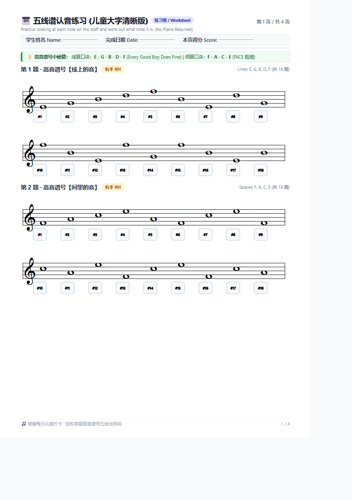
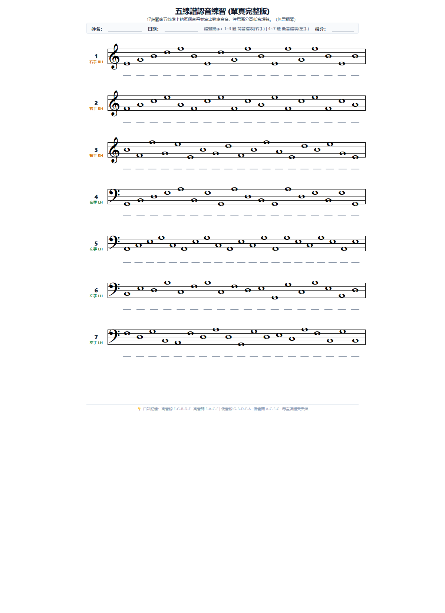
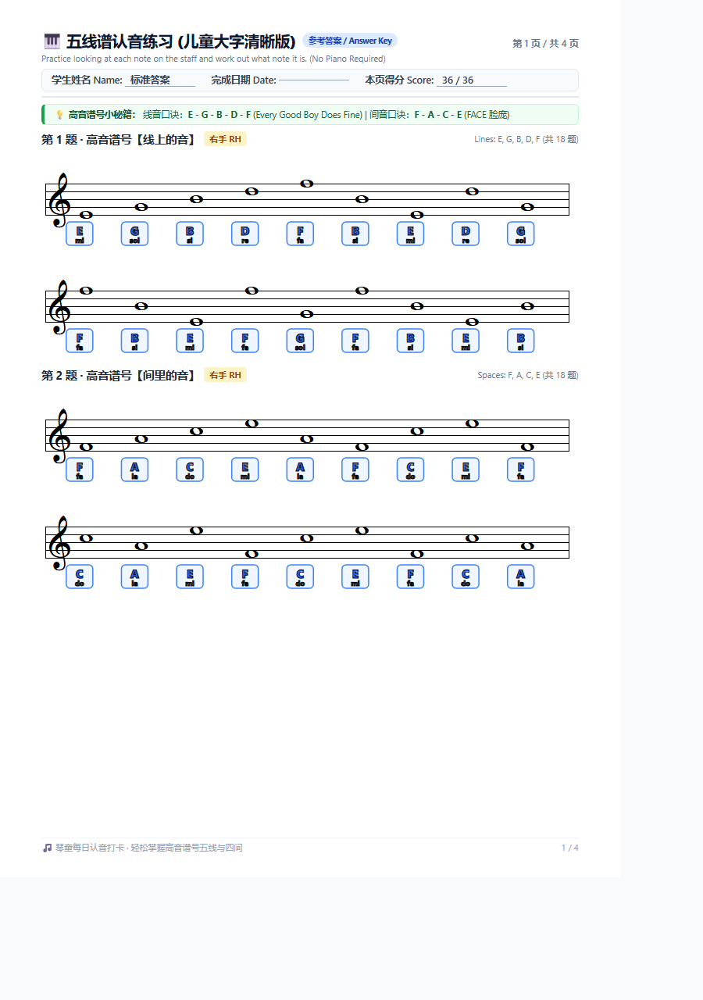
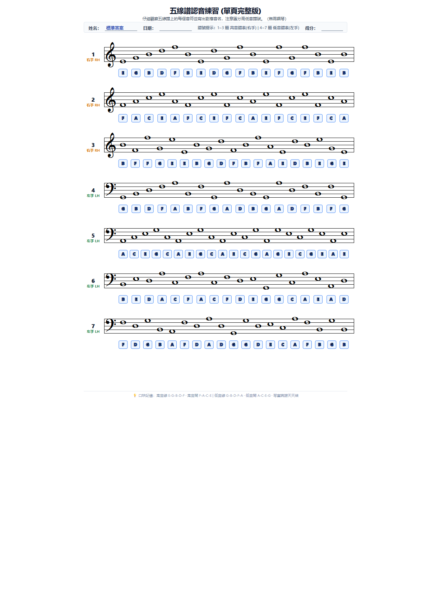

# 🎹 Music Sheet Enhancer

[](https://github.com/klkkeio/music-sheet-enhancer/actions/workflows/ci.yml)
[](LICENSE)
[](SECURITY.md)
[](package.json)
[](locales/)

> **Transform blurry photocopies and degraded music sheets into crystal-clear, publication-grade vector workbooks, single-page sheets, and automated answer keys.**  
> 將模糊不清的五線譜影印件、琴譜掃描件轉換為高畫質、超清晰的兒童大字版認音練習本、單頁譜表與對照答案！

---

## 🌟 Highlights & Features

- 🎼 **Vector Sharpness**: Reconstructs notes into pure SVG vector graphics using [VexFlow 5](https://www.vexflow.com/), completely eliminating photocopier grain, skew, and low-resolution blur.
- 👶 **Kids Large-Print Workbook (`workbook`)**: 4-page spacious layout featuring oversized staves (`135px`), individual `#1`..`#n` numbered answer boxes, mnemonic cards, and motivational milestone footers.
- 📄 **Single-Page Restored Sheet (`single`)**: Compact 1-page sheet restoring 7 staves with answer underline blanks for paper-saving daily practice.
- 🔑 **Automated Answer Keys (`*-answers`)**: Paired answer workbooks and single sheets with bold pitch letters (`C`, `D`, `E`...) and solfège syllables (`do`, `re`, `mi`...) for teachers, parents, and self-checking students.
- 🌐 **Multi-Lingual & Extensible (i18n)**:
  - **English (`en`)**: Standard international music education terminology.
  - **Traditional Chinese - Taiwan (`zh-TW`)**: 繁體中文（台灣習慣：姓名、練習卷、參考答案、高音譜號小秘笈）.
  - **Traditional Chinese - Hong Kong (`zh-HK`)**: 繁體中文（香港習慣：姓名、工作紙、參考答案、高音譜號小錦囊）.
  - **Simplified Chinese (`zh-CN`)**: 简体中文（姓名、练习卷、参考答案、高音谱号小秘籍）.
  - **Extensible BCP 47 matching**: Auto-resolves culture variants (`en-US`, `en-AU`, `zh-Hant`, `zh-Hans`, `zh-SG`, `zh-MO`) and supports custom translation files (`--locale-file`).
- ⚡ **Offline & Standalone**: Emits 100% self-contained HTML files (with embedded VexFlow bundle) that can be opened anywhere without internet or Node.js.
- 🖨️ **Direct PDF Export**: Headless browser printing via Microsoft Edge, Google Chrome, or Chromium.
- 🤖 **Universal AI Agent Skill**: Includes [`skills/music-sheet-enhancer/SKILL.md`](skills/music-sheet-enhancer/SKILL.md) compatible with Google Antigravity, Claude Code, Kiro, Cursor, Copilot, and OpenAI Codex.
- 🛡️ **Security Hardened**: Built-in HTML sanitization, strict note pitch grammar validation, path traversal defense, and zero runtime vulnerabilities.

---

## 🖼️ Previews

| Kids Large-Print Workbook (Page 1) | Single-Page Restored Sheet |
|:---:|:---:|
|  |  |

| Kids Answer Key (Page 1) | Single-Page Answer Key |
|:---:|:---:|
|  |  |

---

## 🚀 Quick Start

### 1. Installation

```bash
git clone https://github.com/klkkeio/music-sheet-enhancer.git
cd music-sheet-enhancer
npm install
```

### 2. Command-Line Usage (CLI)

```bash
# Generate all sheets in Traditional Chinese (Taiwan) with PDFs
node bin/cli.js --format all --lang zh-TW --pdf

# Generate 4-page Kids Workbook in Traditional Chinese (Hong Kong)
node bin/cli.js --format workbook --lang zh-HK --pdf

# Generate Single-page sheet in English
node bin/cli.js --format single --lang en --pdf

# Generate Simplified Chinese Answer Key
node bin/cli.js --format workbook-answers --lang zh-CN

# Use custom exercises data file and output to a custom directory
node bin/cli.js --data ./my-notes.json --out ./my-output --lang en --pdf
```

### 3. CLI Options Reference

| Flag | Description | Default |
|:---|:---|:---|
| `-f, --format <type>` | Target output: `workbook`, `workbook-answers`, `single`, `single-answers`, or `all` | `all` |
| `-l, --lang <code>` | Culture / language code (`en`, `zh-TW`, `zh-HK`, `zh-CN`, `en-US`, etc.) | `en` |
| `-d, --data <file>` | Path to exercises JSON dataset | `data/note-exercises.json` |
| `-o, --out <dir>` | Destination directory | `dist` |
| `--pdf` | Compile directly to PDF via headless browser (Edge / Chrome) | `false` |
| `--no-html` | Delete temporary HTML files after PDF generation | `false` |
| `--standalone` | Embed VexFlow inline for 100% self-contained offline HTML | `true` |
| `--locale-file <file>` | Path to a custom locale dictionary JSON file | `null` |
| `-h, --help` | Display help guide | |
| `-v, --version` | Display version | |

---

## 📦 Programmatic API

You can use `music-sheet-enhancer` as a library in your own Node.js applications:

```javascript
const {
  generateWorkbookHtml,
  generateSinglePageHtml,
  renderHtmlToPdf,
  createTranslator,
  registerLocale
} = require('music-sheet-enhancer');

const exercises = require('./data/note-exercises.json');

// 1. Generate Kids Workbook HTML
const workbookHtml = generateWorkbookHtml({
  exercises,
  locale: 'zh-TW',
  isAnswerKey: false,
  standalone: true
});

// 2. Generate Answer Key HTML
const answerKeyHtml = generateWorkbookHtml({
  exercises,
  locale: 'zh-TW',
  isAnswerKey: true,
  standalone: true
});

// 3. Compile directly to PDF
const fs = require('fs');
fs.writeFileSync('output.html', workbookHtml);
renderHtmlToPdf('output.html', 'output.pdf');
```

---

## 🌐 Internationalization (i18n) & Adding Languages

### Built-in Languages
- `en` (English)
- `zh-TW` (繁體中文 - 台灣)
- `zh-HK` (繁體中文 - 香港)
- `zh-CN` (简体中文)

### Culture Auto-Negotiation
The resolver handles standard BCP 47 culture tags with automatic fallback:
- `en-US`, `en-GB`, `en-AU`, `en-CA` $\rightarrow$ `en`
- `zh-Hant`, `zh-Hant-TW` $\rightarrow$ `zh-TW`
- `zh-Hant-HK`, `zh-MO` $\rightarrow$ `zh-HK`
- `zh-Hans`, `zh-Hans-CN`, `zh-SG` $\rightarrow$ `zh-CN`

### Extending to New Languages
To add a new language (e.g. Japanese, Spanish, German):
1. Copy `locales/en.json` to your own JSON file (e.g. `ja.json`).
2. Translate the values.
3. Pass it via the CLI:
   ```bash
   node bin/cli.js --lang ja --locale-file ./ja.json --pdf
   ```
   Or register it programmatically:
   ```javascript
   const { registerLocale } = require('music-sheet-enhancer');
   registerLocale('ja', require('./ja.json'));
   ```

---

## 📁 Repository Structure

```
music-sheet-enhancer/
├── .github/
│   └── workflows/ci.yml       # Automated multi-OS tests & security audit
├── bin/
│   └── cli.js                 # Command-line interface
├── data/
│   ├── note-exercises.json    # 7 transcribed exercises (131 whole notes)
│   └── schema.json            # JSON Schema for exercises dataset
├── docs/
│   ├── images/                # Visual previews for documentation
│   └── EXERCISE_SCHEMA.md     # Guide for authoring custom exercise files
├── examples/                  # Ready-to-print sample PDFs
│   ├── Note_Name_Exercise_Kids_Large.pdf
│   ├── Note_Name_Exercise_Answer_Key.pdf
│   ├── Note_Name_Exercise_Single_Page.pdf
│   └── Note_Name_Exercise_Single_Page_Answers.pdf
├── locales/
│   ├── en.json                # English dictionary
│   ├── zh-CN.json             # Simplified Chinese dictionary
│   ├── zh-HK.json             # Traditional Chinese (Hong Kong) dictionary
│   └── zh-TW.json             # Traditional Chinese (Taiwan) dictionary
├── skills/
│   └── music-sheet-enhancer/
│       └── SKILL.md           # Universal Agent Skill for AI coding assistants
├── src/
│   ├── index.js               # Library exports
│   ├── generator.js           # HTML & SVG generation engine
│   ├── i18n.js                # Multi-lingual & culture resolution engine
│   ├── pdf-renderer.js        # Headless browser PDF compiler
│   └── validator.js           # Schema validation & XSS sanitization
├── tests/                     # Automated test suite (Node built-in test runner)
│   ├── cli.test.js
│   ├── generator.test.js
│   ├── i18n.test.js
│   ├── security.test.js
│   └── validator.test.js
├── LICENSE                    # MIT License
├── package.json
├── README.md                  # Project documentation
└── SECURITY.md                # Security policy & vulnerability reporting
```

---

## 🧪 Testing & Security

Run automated unit, integration, and security tests:

```bash
# Run test suite
npm test

# Run dependency vulnerability audit
npm run audit
```

---

## 📄 License

[MIT License](LICENSE) © 2026 klkkeio
